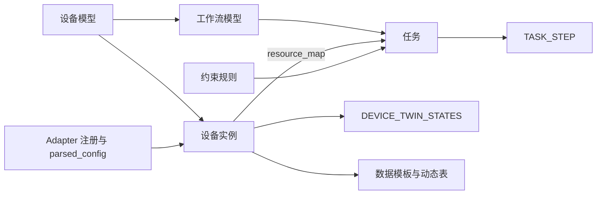
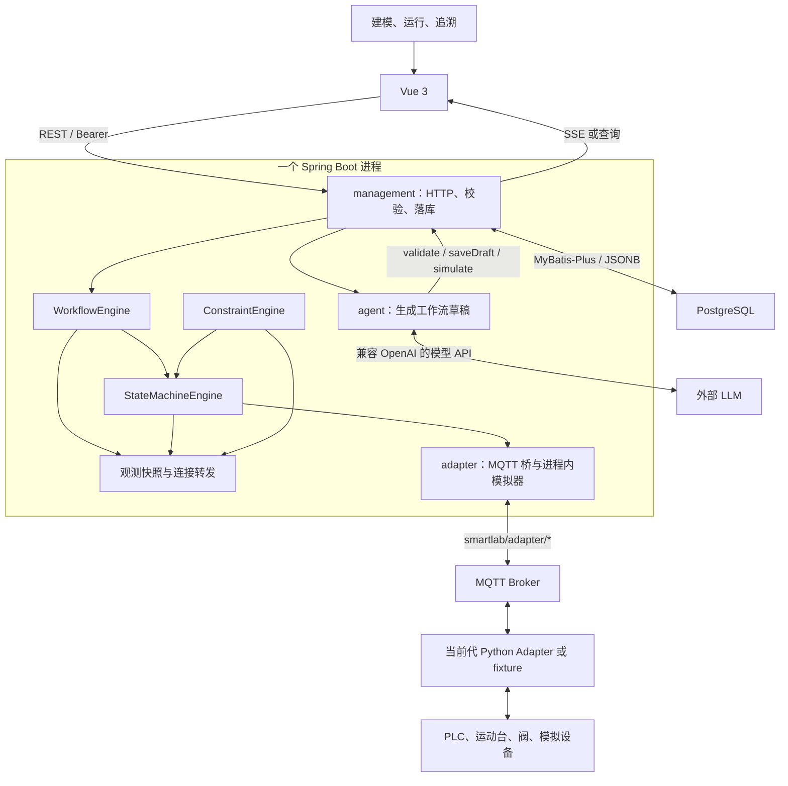
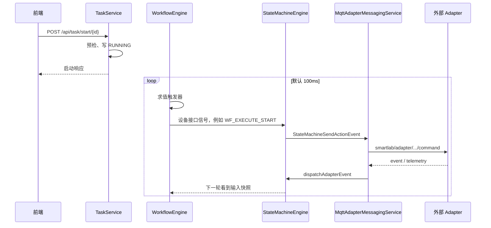

# SmartLab 2.0 项目框架说明

整理日期：2026-10-08。依据当前工作区源码，不是设计稿。文中的“已接线”表示源码里存在这条调用，不表示已经完成现场联调。

同目录里有两份更早的说明，读的时候要分开：

- `system-understanding-2026-09-07.md` 仍适合当阅读手册，对象模型和主执行循环大体还在。
- `protocol-to-runtime-implementation-chain.md` 已经过时。它写运行时从 `protocol-dict.json` 和 JSON Schema 加载契约。仓库里没有 `protocol-dict.json`。`ProtocolDictionaryService` 的注释写明：协议已定稿，运行时直接用固定 Java 契约，不再读取或解释 JSON Schema 文件。

本文先给当前框架，再单独列出三类问题：本该共享却各写一份的地方、链路分叉、层与层之间的边界冲突。

---

## 1. 系统在做什么

SmartLab 把一次化学实验拆成可复用的定义，再绑定到具体设备上执行，并在执行过程中采集数据和检查约束。

它有两种时间：

- **设计时**：设备能做什么、流程怎么协作、信号和数据怎么连、哪些约束必须满足。
- **运行时**：选定具体设备，创建一次任务，下发命令，收回执，推进流程，留下日志、违规记录和实验数据。

先记住六个对象，后面的链路都挂在它们上面。

| 对象 | 回答的问题 | 落在哪里 |
|---|---|---|
| 设备模型 | 这一类设备有哪些属性、能力、状态机、固有约束、数据端口、Adapter 契约 | `DEVICE_MODELS` |
| 设备实例 | 这一台设备属于哪个模型、绑在哪个 Adapter 点位、是真机、租约虚拟机还是画布临时机 | `DEVICE_INSTANCES` |
| Adapter 注册项 | 哪一个设备侧进程在线，它的能力清单解析结果是什么 | `ADAPTER_INDEX` |
| 工作流模型 | 节点、控制信号连线、数据端口连线如何组成一个可复用实验 | `FLOW_MODELS` + `FLOW_NODE` |
| 任务 | 某次运行用哪版流程、绑了哪些实例、任务变量和任务约束是什么 | `TASK` + `TASK_STEP` |
| 约束规则 | 对可观测量的表达式、绑定和违约动作 | `CONSTRAINT_RULE`；任务上还有一份 `task_constraints` |

设备模型回答“需要什么类型”。任务的 `resource_map` 回答“这次用哪一台”。这两次绑定是流程复用和设备执行之间的接缝。

实例还有第三种时间尺度上的种类，和任务的执行种类不是一回事：

- `DEVICE_INSTANCES.instance_kind`：`PHYSICAL` 真机、`VIRTUAL` 租约虚拟点、`TEMPORARY` 画布走图用的临时实例。
- `TASK.execution_kind`：`PRODUCTION` 正式执行、`SIMULATION` 模拟执行。

`TEMPORARY` 不进全局约束观测，也不能手动点动。`VIRTUAL` 和 `PHYSICAL` 可以点动，也进入约束可见集。见 `DeviceInstanceKind`。

---

## 2. 部署形态

前端是 Vue 3 管理端。后端是一个 Java 21 / Spring Boot 3.3.5 进程。`management`、`engine`、`adapter`、`global`、`agent` 是同一个进程里的包，不是五个微服务。

默认后端端口 8080。前端开发代理把 `/api` 转到这个端口。页面主链路是 REST、SSE 和定时查询。依赖里出现 WebSocket，不表示页面主链路走 WebSocket。

仓库根目录把设备侧程序和后端拆开：

- `Backend/`：上面这个 Java 进程。
- `Frontend/`：管理端。
- `adapter/`：独立设备侧工程。里面有多代实现，不能当成同一套已经接通的运行时。
- `fixture/`：联调夹具。反应釜 fixture 接近当前契约；温度模拟器更瘦，没有租约。
- `docs/`：设计稿和架构说明。设计稿不能代替当前调用链。

---

## 3. 代码分层：名义职责

这些是包注释和目录约定里的职责。第 8 节写实际越界的地方。

| 位置 | 该负责 | 不该负责 |
|---|---|---|
| `com.smartlab.management` | HTTP、DTO、实体、Mapper、保存与发布、任务预检 | 工作流作者语言的第二套语义 |
| `com.smartlab.engine.workflow` | 把已落库模型编译成可执行图，轮询触发器，执行 `EMIT` / `UPDATE` | 自然语言生成 |
| `com.smartlab.engine.statemachine` | 每台实例的指令状态、运行状态、`SEND` 出站、Adapter 事件入站 | 任务编排 |
| `com.smartlab.engine.constraint` | 按观测快照求值规则，执行停任务、暂停、告警或设备能力 | 改工作流图 |
| `com.smartlab.engine.observation` | 设备孪生、状态机、工作流节点三类快照的内存读口 | 自己发明观测键 |
| `com.smartlab.engine.connection` | 接口信号转发、端口取值 | 决定设备协议 |
| `com.smartlab.adapter` | Manifest 解析、MQTT 收发、`TEMPORARY` 进程内回灌 | 工作流分支 |
| `com.smartlab.global` | 枚举、协议字典、Schema 元数据、安全、跨层事件 | 厂商 LLM 客户端 |
| `com.smartlab.agent` | 调用模型工具，产出 `WorkflowModelDocument`，再交给现有 `WorkflowService` | 改编译器、规范器或保存语义 |

前端页面按业务切开：设备模型、设备实例、Adapter、数据、流程设计器、任务、约束、用户、首页。Pinia 只有三处全局状态：登录与菜单、设备控制台 SSE、Agent 会话。其余页面状态留在组件里。

---

## 4. 持久化地图

表名以实体上的 `@TableName` 为准。`TaskStep` 的类注释写成 `TASK_STEPS`，实际表名是 `TASK_STEP`。

**资源**

- `DEVICE_CATEGORY`、`DEVICE_MODELS`、`DEVICE_INSTANCES`、`DEVICE_TWIN_STATES`、`DEVICE_COMPONENTS`、`PROPERTY_TYPE`、`RESOURCE_STRUCTURE`
- `ADAPTER_INDEX`、`VIRTUAL_LEASE`
- `SCENE_MAIN`、`SCENE_DETAIL`：场景展示，不是工作流引擎的执行图

**流程与任务**

- `FLOW_MODELS`：`DRAFT` 可改；`ACTIVE` 才能进入正常任务。已发布版本再改会建后继版本，避免盖掉正在跑的定义。
- `FLOW_NODE`：节点定义。
- `TASK`：`resource_map`、`task_variables`、`task_constraints`、`execution_kind`、`task_status`。
- `TASK_STEP`：一次节点运行。接口入出快照、端口入出快照、变量空间都在这里的 JSONB 字段里。子流程用 `parent_step_id` 和 `step_depth` 挂成树。
- `EXECUTION_LOG`

**约束与数据**

- `CONSTRAINT_RULE`、`VIOLATION_LOG`
- `DATA_TEMPLATE_MAIN`、`DATA_TEMPLATE_DETAIL`、`DATA_INDEX`
- 实验采样不进上面这几张固定表。`DATA_INDEX.data_table` 指向一张动态物理表，`DataRecordService` 按表名读写。

**用户**

- `USER_INFO`、`PERMISSION_INFO`。登录返回 token、用户、菜单和权限。路由按菜单 path 放行；按钮再查 `object:action`。`system_admin` 在前端全放行。

设备模型上的大 JSON 是设计时合同：`attributes`、`capabilities`、`adapter_contract`、`ports`、`intrinsic_constraint`、`state_machine_interfaces`、`op_state`、`cmd_state`、`state_transitions`、`components_bom`。

---

## 5. 两条连接，一种执行方式

工作流图在编译期按 `NODE_TO_NODE` 做拓扑检查，这一层是有向无环图。运行不是按拓扑序把节点逐个跑完。

`WorkflowEngine.driveWorkflows` 默认每 100ms 扫描 `RUNNING` / `TERMINATING` 任务。同一任务用内存里的 `pendingTaskIds` / `inFlightTaskIds` 去重，再进线程池。HTTP 启动接口只把任务写成 `RUNNING`，不在同一次请求里把图跑完。

每一轮对进入范围的步骤做这些事：

1. 冻结变量快照，刷新输出端口。
2. 遍历接口上的 `bindingTriggers`。条件从假变真才执行动作，避免条件一直为真时每轮重入。
3. `UPDATE` 改受支持的状态或变量。`EMIT` 从指定接口发信号。
4. 信号沿接口连接送到别的节点或设备。设备回执写入目标步骤的输入快照，下一轮再求值。
5. 子流程仍在同一个任务里。子流程 `END` 向父步骤送 `SUBFLOW_COMPLETED`。根 `END` 成功后走任务完成。

因此“线连上了”只说明有路径。触发器、信号名、变量、设备状态和聚合条件不满足，图会停住。

**Interface** 传控制信号：开始、完成、失败、条件满足，可以带映射载荷。转发入口是 `InterfaceConnectionForwarder`。

**Port** 传值。源节点把值放在输出端口，`PortConnectionPuller` 拉到目标的输入快照和变量。端口连接不会单独把下一节点启动起来。

工作流节点动作类型只有 `EMIT` 和 `UPDATE`。状态机出站动作是 `SEND`。这是两套动作，不要混成一种“节点命令”。

节点大类是 `DEV_NODE`、`FUNC_NODE`、`SUBFLOW_NODE`。功能节点再分 `START`、`END`、`BRANCH`、`AGGREGATE`。系统骨架由 `WorkflowNodeSystemContract.templates()` 生成。编译前 `WorkflowDefinitionCanonicalizer` 用这套骨架盖住节点的系统部分，保留业务项。

---

## 6. 一条正式任务怎么走到设备

这是 `PRODUCTION` + `PHYSICAL` 的主链。模拟和临时实例在第 8 节从这里分叉。

设备下行的方法级路径：

1. 触发器命中 `EMIT`，接口类型是状态机接口。
2. `DefaultWorkflowExecutionOperations.dispatchDeviceSignal` → `InterfaceConnectionForwarder.forwardToDevice` → `StateMachineCommandPort.dispatchInputSignal`。
3. `StateMachineEngine` 进入执行，跑到 `SEND`。
4. `SendStateMachineActionExecutor` 发布 `StateMachineSendActionEvent`。
5. `MqttAdapterMessagingService.handleStateMachineSendAction` 只处理 `interfaceType == ADAPTER` 且信号为 `CMD_START` 或 `CMD_ABORT`。
6. `PHYSICAL` / `VIRTUAL` 由 `AdapterPayloadMapperService.buildCommandMessage` 组包，再 `publishCommand`。

回程分成两条，不要收成一条“设备回调”：

- **指令事件**：MQTT event → `AdapterPayloadMapperService.applyAdapterEvent` → `StateMachineEngine.dispatchAdapterEvent`。状态变化再由 `InterfaceConnectionForwarder.onStateMachineSignal` 写入节点输入，并 `requestPoll`。
- **遥测**：MQTT telemetry → 补丁 `DEVICE_TWIN_STATES` → `DeviceTelemetryUpdatedEvent` → `DeviceTwinSnapshotRegistry` 发 `ObservableChangedEvent` → `ConstraintEvaluationCoordinator` 求值约束。

约束违约不直接唤醒工作流触发器。系统动作走 `WorkflowTaskControlService`，改任务为终止、暂停或只告警（`ABORT` / `PAUSE` / `ALERT`）。设备能力动作走 `StateMachineEngine` 的 `CONSTRAINT_EXECUTE`。工作流要等下一轮轮询，从设备状态接口快照里看到变化。

设备模型上的固有约束另有一条：`IntrinsicConstraintMonitor` 默认 100ms 读孪生快照，调用 `StateMachineEngine.evaluateIntrinsicConstraints`。它和全局 `ConstraintEngine` 并行，作用域不同。

状态机信号的生产监听者是 `InterfaceConnectionForwarder.onStateMachineSignal`，以及更早执行的 `DeviceConsoleSseHub.handleStateMachineSignal`（控制台 SSE）。`WorkflowEngine` 里还有一个同名的包内方法，生产代码没有调用它。

---

## 7. 已经共享的合同

这些地方是单一事实来源，后文的重复都是相对它们而言。

**运行时契约在 Java，不在 JSON 文件。**

`com.smartlab.global.contract` 持有节点类型、信号、生命周期、MQTT 主题、约束运算符、数据类型、违约动作。`ProtocolDictionaryService` 在运行时解释这套 Java 合同。`Backend/src/main/resources/schemas/` 下的六份 JSON（协议、设备能力、状态机、工作流、约束、系统执行）通过 `SchemaContractConformanceTest` 与 Java 对齐，不是前后端共同解析的运行时层。

**前端能拿到的那一份元数据来自同一个 Java 出口。**

`GET /api/schema-metadata/frontend` → `SchemaMetadataService.frontendMetadata()`。内容包括协议枚举、状态机标准接口和系统转移、工作流节点模板、生命周期、时序函数说明、约束对象类型和运算符。设备模型编辑器通过 `deviceModelConstants.js` 的 `applyProtocolMetadata` 灌进下拉框。流程设计器通过 `configureWorkflowNodeTemplates` 使用 `workflow.nodeTemplates`。节点系统骨架因此和 `WorkflowDefinitionCompiler` 同源。

**工作流保存只有一条权威门。**

手工设计和 Agent 都走 `WorkflowService.validate` / `saveDraft` / `publish`。里面先 `WorkflowModelDocuments.sanitizeDocument`，再 `WorkflowDefinitionCompiler.prepare`（规范器 + 严格编译）。发布还要过设备配置和子流程 `ACTIVE` 引用。Agent 的 `ValidateWorkflowTool`、`SaveDraftTool` 没有绕开编译器。`SimulateWorkflowTool` 走的是结构模拟，不写草稿。

**约束规则的保存校验在后端。**

`ConstraintRuleService.validate` 使用 `ConstraintExpressionEvaluator`。前端表达式编辑器是录入辅助。

**观测读口按对象类型分派。**

`ObservableObjectType` 有六类：设备属性、设备运行状态、设备指令生命周期、节点生命周期、节点内部变量、任务生命周期。`ObservableSnapshotService.read` 按类型分到三个注册表。

---

## 8. 本该共享、实际没有共享

### 8.1 工作流规则写了两遍

后端权威是 `WorkflowDefinitionCanonicalizer` + `WorkflowDefinitionCompiler`。前端平行实现在：

- `Frontend/src/utils/workflowNodeDefinition.js`：节点校验、系统模板回填、默认触发器。
- `Frontend/src/utils/workflowDesignerRules.js`：拓扑、聚合阈值、时序函数白名单、复制命名。
- `Frontend/src/utils/workflowAuthoring.js`：文档形状和编辑器专用字段，与 `WorkflowModelDocuments` 的 `EDITOR_ONLY_KEYS` 成对维护。

前端这份会挡住编辑，也会漏检。已经对上的差异：

- 触发器比较符：编译器要求 `ConstraintOperator.supports`。前端 `validateTriggerPredicate` 不校验 operator。界面可以显示通过，发布时后端拒绝。
- 相等号有两套。约束运算符的相等是 `"="`。聚合阈值计数在编译器和 `workflowDesignerRules.js` 里同时接受 `"="` 和 `"=="`。触发条件写成 `"=="` 会被 `supports` 拒绝。
- 前端拓扑额外要求从 `START` 可达。后端检查入出边和环，不检查从 `START` 可达。前端更严，而且只严在界面上。
- `NODE_LIFECYCLE` 的 `UPDATE`：后端要求存在到达目标状态的转移，前端更松。
- 聚合阈值、流程复制命名、`ACTIVE`/`DRAFT` 字符串，两边各写一份相近规则。

节点模板虽然从元数据接口灌进来，新建工作流接口时前端仍硬编码 `allowedSignals: ['ACTIVE']`。动作白名单 `UPDATE`/`EMIT` 也在前端再写一遍。

### 8.2 表达式语言写了两遍

`ConstraintExpressionEvaluator` 是求值器。约束函数是 `delta`、`avg`、`rate`。工作流赋值额外允许 `max`、`min`、`abs`。

前端 `constraintExpression.js` 是另一套解析器。展示式使用 `@变量`，保存前用 `toBackendExpression` 去掉 `@`。比较符列表含 `==`。约束编辑器可以在后端拒绝之前先放过一条表达式。

工作流时序函数的中文名和示例在 `SchemaMetadataService.temporalFunctions` 与 `workflowDesignerRules.js` 各有一份。函数名应对齐 Java 的 `WORKFLOW_FUNCTIONS`，但前端校验白名单是本地的。

`SchemaMetadataService` 里还有一个命名碰撞：`workflowCalculationOperators()` 返回的是约束比较符；`workflow.calculationOperators` 字段放的是 `+ - * / ( )`。同一次元数据响应里，两个“运算符”不是一件事。

### 8.3 设备模型形状写了两遍

`DeviceModelService.validateForPersistence` 是保存权威。前端 `normalizers.js`、`deviceModelLifecycle.js`、`deviceModelConstants.js` 在编辑时再归一化状态机、Adapter 契约、能力和固有约束。模型侧是 JavaScript，实例侧是 `normalizers.ts`。两边都有 `normalizeOperator` 一类逻辑，没有共用模块。

元数据没加载时，设备模型编辑器用硬编码兜底 `CMD_START`、`CMD_ABORT`、`OP_STATE`。值和后端枚举一致，来源不是元数据接口。

设备固有约束只允许六个比较符。全局 `ConstraintOperator` 还有 `BETWEEN` 和 `IN`。前端下拉会滤掉后两个，和固有约束一致，和全局枚举不一致。

### 8.4 任务绑定和预检写了两遍

`GET /api/workflow/{id}/requirements` 和 `TaskService.preflight` 是权威。前端 `taskResourceBindings.js` 自己展开子流程、设备槽和接口配对，用来画绑定图。展开规则和后端收集规则可以漂移，循环和接口配对尤其明显。

创建任务前，`TaskList.vue` 先做本地检查（名称、绑定、空参数、约束复核），通过后再 `POST /api/task/preflight`。`taskPreflightPresentation.js` 只翻译一部分 issue code，其余用后端 `message`。

运行展示层 `workflowExecution.js` 把 `COMPLETED` 显示成 `SUCCEEDED`，把 `ABORTED` 显示成 `TERMINATED`。这是前端别名，后端生命周期不用这层翻译。

### 8.5 HTTP 客户端没有生成物，页面也没有收口

没有 OpenAPI 生成的前端客户端。`pom.xml` 没有 springdoc。`SecurityConfig` 放行了 `/v3/api-docs/**`，仓库里没有对应的文档生成。

名义上的 API 模块只有 `workflowApi.js`、`taskApi.js`、`frontendContractMetadata.js`，外加设备模型/实例两份页面内 API。任务列表的保存、启动、终止、删除、分页仍在 `TaskList.vue` 里直接调用 axios。`utils/request.js` 没有任何引用。设备、数据、约束、用户页面几乎各自写 URL。

鉴权也有两套入口：axios 拦截器带 Bearer；SSE 把 token 放在查询参数上。

### 8.6 约束产品有三条线，只共享了编辑器的一部分

| 线 | 编辑入口 | 保存位置 | 运行时谁求值 |
|---|---|---|---|
| 全局/任务规则 DSL | `ConstraintRuleEditor.vue` | `CONSTRAINT_RULE`，或任务上的 `task_constraints` | `ConstraintEngine` |
| 设备固有阈值 | `InstanceConstraintsTab.vue`，另一套表格 | 设备模型 `intrinsic_constraint` | `IntrinsicConstraintMonitor` |
| 任务生效视图 | `TaskExecutionDrawer` 只读 | `GET /api/constraint/model/task/{id}` | 编译后的 `EffectiveConstraintModel` |

全局约束页的可观测类型来自 options 接口。任务里的约束编辑器仍手写类型列表。

### 8.7 Adapter 北向协议复制了多份，代际还没收拢

当前 Java 桥只认 `smartlab/adapter/*`：注册、心跳、`{devicePoint}/command|telemetry|event`、租约请求和结果。载荷字段是 `messageId`、`adapterName`、`devicePoint`、`commandName`、`parameters`、`timestamp`。见 `MqttTopic` 和协议规范 Schema。

与这套契约对齐、并且带租约的外部实现，是 `adapter/new/` 下的 GetPLCData、MotionStageController、ValueAdapterMQTT，以及 `fixture/adapter/反应釜`。三份 `adapter/new/*/core.py` 是同一套北向运行时的复制，设备差异在各自的 `control.py` / `simulation.py`。反应釜 fixture 的 `core.py` 是近复制，不是同一文件。

这些路径不在同一契约上，不能被 `publishCommand` 直接驱动：

- 旧 C++ `adapter/ValueAdapterMQTT`：主题是 `smartlab/v1/...`，命令字段是 `commandId`。
- 旧 C++ `adapter/MotionStageController`：契约字典使用 `smartlab/device/{deviceId}/...`，工程还缺头文件。
- 旧 C++ `adapter/GetPLCData`：没有 SmartLab MQTT 实现。
- `adapter/edge-agent-runtime`：主题可配置，示例默认不是 `smartlab/adapter/*`。
- `adapter/testAdapter`：北向主题对齐，但没有租约，不能走 `VIRTUAL`。
- `fixture/adapter/温度模拟器`：有注册、心跳、遥测和命令，没有租约。
- `adapter/camera`：RTSP/HTTP，不进 Adapter 桥。

进程内模拟器不运行这些 Python 文件。它读数据库里的 `ADAPTER_INDEX.parsed_config`。

### 8.8 图组件和布局没有进模型

设计器、任务绑定、运行监控共用 `WorkflowCanvasNode` / `WorkflowCanvasEdge` 和 `workflowCanvas.js` 的一部分布局函数。Vue Flow 的状态机是各写一套：可编辑设计器一套，只读 `WorkflowStageGraph` 一套，`TaskRuntimeGraph` 是后者的运行态包装。

节点坐标存在浏览器 `localStorage`（`smartlab:workflow-layout:`），不进 `WorkflowModelDocument`。换浏览器或清缓存后，图的几何位置会丢，语义定义还在。

Agent 有两个入口：首页/顶栏的流式 `generateStream`，以及设计器里的另一条生成调用。生成结果不会自动打开设计器，草稿 id 从多种字段里解析。

---

## 9. 链路混乱

### 9.1 三种“模拟”不是一条链路

| 入口 | 实际行为 | 设备实例 | 谁推进 |
|---|---|---|---|
| 设计器或 Agent 的 simulate | `WorkflowSimulationService` → `WorkflowStructureWalker` | 为设备模型创建 `TEMPORARY` | 结构遍历。只跟 `NODE_TO_NODE`。不求值分支。不启动 `WorkflowEngine` |
| 任务 `execution_kind=SIMULATION` | 启动时 `VirtualLeaseService.acquireForTask`，运行中 `remapIfSimulation` | 租约出来的 `VIRTUAL` 点 | 真 `WorkflowEngine` 轮询。出站仍走 MQTT，打到虚拟点 |
| `TEMPORARY` 出站 | `MqttAdapterMessagingService` 看见临时实例就改道 | 已是 `TEMPORARY` | `InProcessAdapterSimulator`。不 `publishCommand` |

结构遍历的设备探测是同步 `dispatchInputSignal`，再轮询孪生 CMD。正式任务是异步 MQTT 或异步回灌。`WaitWorkflowActionExecutor` 还有一个特例：模拟任务且绑定实例全是 `TEMPORARY` 时，等待立即结束。

因此“模拟通过”有三种含义：画布结构走通、租约虚拟点上的真引擎跑过、临时实例被进程内脚本回灌。它们不能互相代替。

### 9.2 启动和推进被数据库轮询隔开

`POST /api/task/start/{id}` → `WorkflowTaskControlService.start` → `TaskService.start`。控制门面放在 `engine` 包，实现全在 `management`。启动成功后没有立刻 `requestPoll`，要等下一次 `driveWorkflows`。默认间隔是调度检查周期，不是设备完成命令的时延。

同一 JVM 里还有这些定时器，它们看的是同一批任务和孪生状态：

- 工作流驱动，默认 100ms
- 固有约束扫描，默认 100ms
- 全局约束扫描，默认 200ms
- 指令超时扫描，默认 1000ms
- Adapter 心跳，5s
- 虚拟租约清扫，默认 30s
- MQTT 重连

任务锁和 in-flight 集合在当前进程内存里。多实例部署时，这套去重不能跨进程。

### 9.3 终止结算有两份

`TaskService.completeTerminationIfSettled` 和 `WorkflowRuntimeService.completeTerminationIfSettled` 逻辑并列。HTTP 终止在 `requestTermination` 之后同步调用 `TaskService` 那份。引擎在 `TERMINATING` 且没有活跃步骤时调用 `WorkflowRuntimeService` 那份。两次结算可能交错。

### 9.4 工作流保存还有一条遗留入口

`saveDraft` / `publish` / `validate` 走 `compiler.prepare`。`WorkflowService.saveDefinition` 仍直接 `compiler.compile` 再自己持久化。Agent 没有走这条，但它和现行保存路径并列。

### 9.5 设备回执进工作流的路径不好从类名读出来

容易误以为 `WorkflowEngine.handleStateMachineSignal` 是入口。生产路径是：

`StateMachineInterfaceSignalEvent` → `DeviceConsoleSseHub`（只推前端）和 `InterfaceConnectionForwarder.onStateMachineSignal`（写步骤输入并请求轮询）→ 下一轮 `WorkflowEngine.evaluateNodeTriggers`。

控制台监听器标了最高优先级。注释写明：转发器会写库并可能抛错，Spring 默认同线程顺序通知，后面的监听器会被跳过。所以 SSE 必须排在转发器前面。这条顺序是隐式耦合。

### 9.6 前端一条业务链拆在多个缓存上

流程设计器：Vue Flow 状态、`form.nodesDef`、`localStorage` 布局、服务端规范化结果，保存成功后用服务端节点覆盖本地语义，布局键还要按 id 迁移。

任务创建：本地展开的图、`requirements` 接口、`workflow/detail` 缓存、预检结果、`task/save` 载荷，并行维护。启动和监控又把 `taskApi` 与页面内 axios 混在一起。监控抽屉的步骤和日志由父页面用 SSE 推，再防抖拉快照。

设备控制台：全站一条 SSE，日志另存 `localStorage`。这和 `EXECUTION_LOG`、实例详情里每秒拉的 snapshot 不是同一个模型。

---

## 10. 边界冲突

### 10.1 `engine` 和 `management` 互相持有

名义上引擎不负责落库，管理端不负责执行。实际依赖是双向的。

引擎直接使用管理端的服务和 Mapper，例如：

- `WorkflowEngine` 注入 `WorkflowRuntimeService`、`WorkflowService`、`FlowNodeService`
- `StateMachineEngine` 使用孪生状态服务、实例 Mapper、步骤 Mapper
- 三个观测注册表直接用 Mapper
- `EffectiveConstraintModelCompiler` 使用约束规则服务和任务约束服务
- `ConstraintEngine` 写 `ViolationLogService`

管理端也驱动引擎：

- `WorkflowRuntimeService` 发布节点观测事件，并迁移节点和任务状态
- `WorkflowStructureWalker` 放在 `management` 包，直接调状态机端口和 `InProcessAdapterSimulator`
- `AdapterPayloadMapperService` 直接 `dispatchAdapterEvent`

`WorkflowTaskControlService` 放在 `engine` 包，方法体只是转调 `TaskService`。读包名会以为任务控制语义在引擎里。

这不是“可以随便把校验挪进引擎”。工作流作者语言的编译、规范化和保存语义必须留在现有 `WorkflowService` / `WorkflowDefinitionCompiler` / `WorkflowDefinitionCanonicalizer`。Agent 规则明确禁止为了迁就模型输出去改这几处。边界混乱要修的是依赖方向和重复实现，不是把错误稿在引擎里改成对稿。

### 10.2 三份设备描述，用途被拆开

| 名称 | 存在哪里 | 谁消费 |
|---|---|---|
| Adapter 原文 | `adapterSetup.ini` / 注册报文 | 设备侧进程；解析进 `parsed_config` |
| `parsed_config` | `ADAPTER_INDEX` | 注册审阅、点位查询、进程内模拟器的 cmd 事件声明 |
| `adapterContract` | `DEVICE_MODELS` | 下行参数、入站事件是否必须带 `messageId`、模型校验 |

模拟器只用 `adapterContract.config` 里的 `adapterName` 和 `categoryName` 去 `parsed_config` 找模板，再按模板声明的 cmd 事件回灌。它不把模型上的 `commands` / `telemetry` 当脚本，也不写孪生属性。

MQTT 入站却用模型上的 `adapterContract.events.cmdEvents` 决定 `messageId` 是否必需。下行参数映射查的是 `adapterContract.commands`。模型保存时，若契约里带了 `adapterName` 和 `categoryName`，整份契约会被 `parsed_config` 生成的规范形覆盖，只保留用户提交的遥测属性映射。

所以：模拟脚本的事实来源是 `parsed_config`；线上收发的事实来源是 `adapterContract`；两者由保存时的一次生成连起来。改其中一份而不同步另一份，模拟和真机会看到不同的事件表。

### 10.3 观测有多个写入者

统一读口是 `ObservableSnapshotService`。写入不是单点：

- 设备属性：`AdapterPayloadMapperService` 写 `DEVICE_TWIN_STATES`，`DeviceTwinSnapshotRegistry` 再写内存快照。
- 指令/运行生命周期：`StateMachineObservationRegistry` 听状态机信号。孪生表上的 CMD 字段是另一视角。
- 节点变量和节点状态：步骤行在数据库里，`WorkflowRuntimeSnapshotRegistry` 听 `WorkflowNodeObservationEvent`。

`TEMPORARY` 被 `isConstraintVisible` 排除。画布临时实例的属性不会进入全局约束。这是刻意的。若用结构模拟的结果推断约束引擎的行为，会漏掉这条过滤。

### 10.4 进程内回灌和“等 SENT 落稳”的时序

`InProcessAdapterSimulator.handleSendAction` 把回灌丢到 `workflowTaskExecutor`，所以不在 `SEND` 的同一调用栈里把指令跑完。`reply` 里对 `CMD_START` 连续调用两次 `dispatchAdapterEvent`：先 `SENT→RUNNING`，再 `RUNNING→COMPLETED`，中间没有等待 `SENT` 写入孪生表之后再发下一条。

状态机 `beginExecution` 的顺序是先执行 `SEND`，再把 CMD 写成 `SENT` 并补丁孪生。出站监听器可能在 `SENT` 落库之前就进入模拟器队列。结构遍历靠轮询孪生状态判断走通，和这条时序绑在一起。

### 10.5 前端第二事实来源会改变用户看到的可执行性

后端发布、预检、约束保存仍然是最终门。冲突在于界面把本地规则当成已经校验通过：

- 设计器本地 issues 和 `simulate` 指纹可以决定发布按钮能否按下。
- 任务页本地 preflight 可以在请求发出前拦截。
- 约束编辑器的展示语法可以先于后端通过。
- 绑定画布按本地展开结果画槽位，和 `requirements` 不一致时，用户按画布操作。

这些本地规则适合做即时提示。它们现在和后端规则同形，于是变成第二份可执行合同。

### 10.6 文档边界也冲突

`protocol-to-runtime-implementation-chain.md` 把 JSON Schema 描述成运行时加载层。当前代码的运行时加载层是 `com.smartlab.global.contract` + `ProtocolDictionaryService` + `SchemaMetadataService`。按旧文档改加载链，会和现有实现对着干。

`项目目录说明.md` 对包职责的一句话仍然有用。它写于 Agent 包落地之前的建议语气；`com.smartlab.agent` 现在已经存在，并且只通过 `WorkflowService` 保存。

---

## 11. 页面到接口

| 路由 | 页面 | 主要接口 |
|---|---|---|
| `/home` | 首页 | `/api/scene`、`/api/resource/structure`、`/api/device/instance`、`/api/task`、MQTT 状态 |
| `/device-model-management` | 设备模型 | `/api/device` |
| `/device-instance-management` | 设备实例、控制台 | `/api/device/instance`，控制台 SSE `/api/device/instance/console/stream` |
| `/adapter-management` | Adapter 注册 | `/api/adapter/index`、`/api/adapter`，待注册 SSE |
| `/data-management` | 数据模板与记录 | `/api/data/*` |
| `/task-designer` | 流程设计 | `/api/workflow`、`/api/schema-metadata/frontend`、`/api/agent/workflow` |
| `/task-management` | 任务 | `/api/task`，运行 SSE `/api/task/stream/{taskId}` |
| `/constraint-management` | 约束规则 | `/api/constraint/rule`、`/api/constraint/model`、`/api/constraint/violation` |
| `/user-management` | 用户权限 | `/api/user`、`/api/permission` |

实时更新没有单一通道。任务监控是 SSE 加补拉。实例详情和虚拟点控制约每秒拉 snapshot。任务列表约 3 秒拉分页。首页和 Adapter 页对 MQTT 状态是更慢的轮询。约束详情抽屉另有遥测定时器。

---

## 12. 读代码时从哪里进入

| 要理解的事 | 先打开 |
|---|---|
| 一份流程如何变成可执行图 | `WorkflowService` → `WorkflowDefinitionCompiler.prepare` |
| 任务为何会往前走 | `WorkflowEngine.driveWorkflows` → `evaluateNodeTriggers` |
| 信号如何到下一节点或设备 | `InterfaceConnectionForwarder` |
| 数值如何到下一节点 | `PortConnectionPuller` |
| 设备指令状态如何迁移 | `StateMachineEngine` |
| 命令如何离开进程 | `MqttAdapterMessagingService.handleStateMachineSendAction` |
| 画布模拟如何走图 | `WorkflowSimulationService` → `WorkflowStructureWalker` |
| 临时实例如何假装 Adapter | `InProcessAdapterSimulator` |
| 模拟任务如何换成虚拟点 | `TaskService.start` → `VirtualLeaseService` → `WorkflowTaskResourceService.remapIfSimulation` |
| 约束如何作用到任务或设备 | `ConstraintEvaluationCoordinator` → `ConstraintEngine` |
| 前端下拉框的枚举从哪来 | `SchemaMetadataService.frontendMetadata` |
| 模型生成的稿子从哪进系统 | `AgentLoop` 的 `ValidateWorkflowTool` / `SaveDraftTool` |

刻意保持的边界：

- Agent 只调用现有 `WorkflowService`。写错的稿子应在校验 issues 里暴露，不在引擎里改写。
- 进程内模拟器只回 `parsed_config` 声明的 cmd 事件。不写孪生属性，不把 `adapterContract.telemetry` 当模拟脚本。
- 结构遍历是编排层的走图器。不要把 `WorkflowEngine` 改成“把所有路径都执行一遍”的模拟器。

---

## 13. 问题优先级

按“两边各写一份、而且会让用户或设备看到不同结果”排序：

1. 工作流编译规则与前端 `workflowNodeDefinition.js` / `workflowDesignerRules.js` 双实现。触发器运算符和可达性已经分叉。
2. 约束/工作流表达式双解析器，加上 `"="` 与 `"=="` 的分工不清。
3. `parsed_config` 与 `adapterContract` 分工正确，但保存覆盖、入站校验、模拟脚本各读一份，改一处会让模拟和真机不一致。
4. 三种模拟入口共用“模拟”这个词，执行引擎、实例种类和是否走 MQTT 都不同。
5. `engine` 与 `management` 双向依赖，终止结算和 `saveDefinition` 各有并列实现。
6. `adapter/new` 三份相同的 `core.py`，以及仍留在仓库里的 C++ / edge-agent / testAdapter 旧协议。
7. 前端 API 与鉴权入口分散。任务页一半走 `taskApi`，一半直接 axios。

第 1、2、5 点适合收成共享模块或删掉遗留入口。第 3、4 点首先是把事实来源写清楚，避免再增加第四条模拟路径。第 6 点是仓库卫生：当前桥只服务 `smartlab/adapter/*` 这一代。
